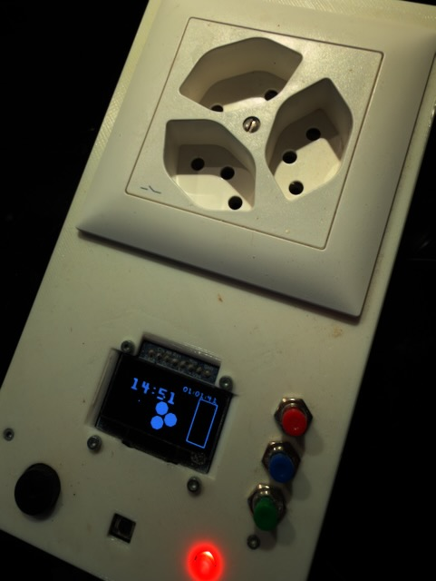

# The Pi Kneader

A Raspberry Pi that runs my bread dough through a full knead-and-rest programme, so I don't
have to stand next to the machine with a kitchen timer.

The Pi switches the kneading machine's mains socket through a relay, walks through the whole
sequence of kneads and breaks, and shows what it's doing on a small OLED. When it needs a human,
it plays a tune.



*The finished controller — the kneading machine plugs into the socket on top, the OLED shows
the programme, and the buttons live underneath.*

---

## The programme

Press the button and it works through the sequence on its own:

| Step | Machine | Display says |
|---|---|---|
| Knead | on | *"Button pressed! kneading very hard"* |
| First break | off | *"taking a first break — relax with Max"* |
| Quick knead | on | *"just a quick first knead"* |
| Second break | off | *"second break"* |
| Quick knead | on | *"second quick kneading"* |
| Last break | off | *"taking the last break"* |
| **Oven** | off | *"switch the oven on!"* → plays **Crazy Frog** |
| Final knead | on | *"nearly finished, just a second"* |
| Baking | off | **Popcorn** plays when it's time to turn the temperature down |
| Done | off | **The Final Countdown** |

Before you start, the display works out and shows the **finishing time** — it takes the
programme length, adds it to the clock, and tells you when the bread will be out, so you can
decide whether you really want to start baking at half past nine.

The melodies aren't decoration. The Pi can't turn the oven on or change its temperature, so
it makes a noise loud enough to fetch someone who can.

---

## Hardware

- Raspberry Pi
- Relay on GPIO 17, switching the kneading machine's socket
- SSD1306 OLED (128×64) over SPI — CS on D5, DC on D6, reset on D4
- Push button on GPIO 26
- Red LED on GPIO 23
- DHT11 temperature and humidity sensor
- Buzzer for the melodies

## Files

```
Pi_kneader.py       the main programme
finishing_time.py   works out when the bread will be done
melody.py           buzzer tunes
dht11.py            temperature and humidity sensor driver
```

## Dependencies

```
gpiozero
adafruit-circuitpython-ssd1306
adafruit-blinka
pillow
```

The display uses a bitmap font at `/home/pi/slkscr.ttf` — point that at whatever font you have.

---

## A warning

This switches **mains voltage** through a relay to drive a kitchen appliance. If you build
something like it, do the mains side properly and don't leave it running unattended.

Also note the step timings in `Pi_kneader.py` are currently set to 5 seconds each for testing.
The real durations are in the comments next to them (720 s knead, 900 s rest, and so on) —
put those back before you trust it with actual dough.
